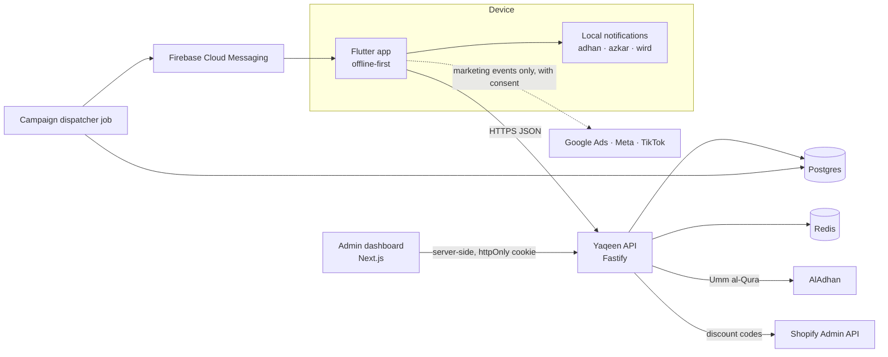

# يقين · Yaqeen

تطبيق إسلامي متكامل: القرآن، الصلاة والقبلة، الأذكار والأدعية، الحفظ، التقويم الهجري، وتحدي **365 يوماً من اليقين** بنقاط تُستبدل هدايا من متجر [yaqin-brand.com](https://www.yaqin-brand.com).

A premium Islamic app for iOS and Android with a points challenge whose rewards are redeemed as Shopify discount codes, plus an admin dashboard that runs the whole system.

## What's in this repo

| Path | What | Stack |
| --- | --- | --- |
| `apps/mobile` | iOS + Android app | Flutter, Riverpod, go_router |
| `apps/admin` | Admin dashboard (Arabic RTL) | Next.js 15 App Router, Tailwind 4 |
| `services/api` | API for the app and the dashboard | Fastify 5, Drizzle ORM, Postgres 16, Redis 7 |
| `packages/contracts` | Shared request/response schemas | zod 4 (TypeScript) |
| `packages/design-tokens` | Colours, tints, brand gradient, radii, motion, fonts | JSON → generated CSS (mirrored in Flutter `tokens.dart`) |
| `packages/brand` | Logo files, app icons (iOS/Android/web), splash, brand fonts slot | Designer originals + `scripts/generate.py` |
| `docs/` | Architecture, data model, API, privacy, notifications, analytics, conventions, roadmap, ADRs | |



## Quick start

Requirements: Node 22, pnpm 10 (`corepack enable`), Docker, Flutter ≥ 3.24.

```bash
pnpm install
docker compose up -d                      # Postgres + Redis
cp services/api/.env.example services/api/.env
cp apps/admin/.env.example apps/admin/.env.local
pnpm db:migrate
SEED_ADMIN_EMAIL=you@yaqin-brand.com SEED_ADMIN_PASSWORD='a-long-password' pnpm db:seed
#   ↑ prints an otpauth:// link — add it to your authenticator app for 2FA

pnpm dev:api        # http://localhost:4000/health
pnpm dev:admin      # http://localhost:3000

cd apps/mobile && flutter pub get && flutter gen-l10n
flutter run --dart-define=API_BASE_URL=http://10.0.2.2:4000
```

Checks (same as CI):

```bash
pnpm typecheck && pnpm test                # + TEST_DATABASE_URL=… to include the Postgres integration tests
pnpm --filter @yaqeen/admin build
cd apps/mobile && flutter analyze && flutter test
```

## Non-negotiables

1. **Worship data is private.** It never goes to ad platforms; admins see aggregates only. → `docs/SECURITY_PRIVACY.md`
2. **Points live in an append-only ledger.** Balance = sum; corrections are new rows; every admin change is audited.
3. **Religious content is published only after review by someone other than its author.**
4. **Marketing pushes respect prayer.** No sends near prayer times, during Jumu'ah or quiet hours; max one per day. → `docs/NOTIFICATIONS.md`
5. **Brand & design:** follow `packages/brand/README.md` (Yaqeen Brand Identity 2026). The logo is always the artwork, never typeset. Light splash with the navy logo; brand gradient for the app icon and premium moments; reading and worship screens stay on light porcelain with blue as accent. Liquid glass, Western digits, Arabic RTL first.

## Where to start reading

`docs/ARCHITECTURE.md` → `docs/DATA_MODEL.md` → `docs/API.md` → `docs/CONVENTIONS.md` → `docs/ROADMAP.md` (includes the open decisions).
