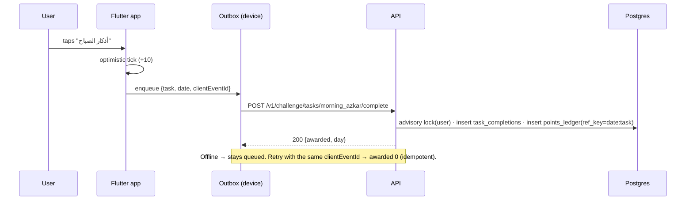

# Architecture

## Components

| Component | Responsibility | Talks to |
| --- | --- | --- |
| **Mobile app** (`apps/mobile`) | All worship features, offline-first. Computes prayer times on-device, schedules local notifications, queues writes in an outbox. | API, FCM, ad SDKs (consented marketing events only) |
| **API** (`services/api`) | Identity, consents, challenge points, rewards, content, remote config, Hijri calendar, admin operations. | Postgres, Redis, AlAdhan, Shopify, FCM |
| **Admin** (`apps/admin`) | Operate the system: users, content review, campaigns, rewards, settings, audit. Calls the API only from the server (no tokens in the browser). | API |
| **Campaign dispatcher** (`services/api/src/jobs`) | Every 10 min: send due campaigns through guardrails. | Postgres, FCM |
| **contracts** | One zod schema per request/response, shared by API + admin, mirrored by hand in Dart models. | — |

## Request flow: completing a challenge task

## Request flow: redeeming points

1. `POST /v1/rewards/:id/redeem` → transaction with a per-user advisory lock: check balance, monthly cap, insert `redemptions` + negative ledger row.
2. Call Shopify `discountCodeBasicCreate` / `discountCodeFreeShippingCreate` (single use, 30-day validity).
3. If Shopify fails → void redemption + compensating `reversal` ledger row. The user never loses points to an upstream error.

## Hijri calendar

AlAdhan (Umm al-Qura, `calendarMethod=UAQ`) is the source, cached in Redis for 30 days per Gregorian month. Egypt can differ by a day after moon sighting, so a `religious_reviewer` sets a regional offset **from a given Hijri month onward** in the admin. The preview rejects any adjustment that would create a month that isn't 29 or 30 days. Users can add a personal ±2 offset.

## Auth

- **App:** Google / Apple ID token (verified against their JWKS) or guest → 15-min HS256 access token (`aud=app`) + rotating opaque refresh token (sha256 stored, single use). Guests can't earn points.
- **Admin:** email + scrypt password + TOTP → 8-hour token with a different secret and `aud=admin`, stored in an httpOnly `SameSite=Strict` cookie. Every admin route declares allowed roles; `super_admin` passes all.

## Deployment (suggested)

- API: container (`services/api/Dockerfile`) on any managed runtime in-region (e.g. Cloud Run / ECS in `me-central` or `eu`), Postgres + Redis managed. Check PDPL cross-border transfer rules before choosing a region (see SECURITY_PRIVACY.md).
- Admin: `next build` standalone output, behind SSO/VPN or IP allowlist in addition to 2FA.
- Dispatcher: scheduled job every 10 minutes running `pnpm --filter @yaqeen/api job:campaigns`.
- Mobile: App Store + Play Store; flavors via `--dart-define=FLAVOR=prod`.
