# Data model

Source of truth: `services/api/src/db/schema.ts`. Migrations: `services/api/drizzle/` (generate with `pnpm db:generate`; CI fails if the schema and migrations drift).

```mermaid
erDiagram
  users ||--o{ auth_identities : "signs in with"
  users ||--o{ refresh_tokens : has
  users ||--o{ devices : "push tokens"
  users ||--o{ consents : "current state"
  users ||--o{ consent_events : "history (PDPL)"
  users ||--o| challenge_enrollments : joins
  users ||--o{ task_completions : completes
  users ||--o{ points_ledger : earns-spends
  users ||--o{ redemptions : redeems
  users ||--o| public_profiles : "public card"
  users ||--o{ user_backups : "opt-in cloud backup"
  users ||--o{ avatar_photos : "profile photo"
  users ||--o| community_members : "opt-in community"
  users ||--o{ community_blocks : blocks
  users ||--o{ points_earned_daily : "derived (trigger)"
  users ||--o| user_point_totals : "derived (trigger)"
  league_weeks ||--o{ league_groups : has
  league_groups ||--o{ league_members : has
  users ||--o{ league_members : "plays in"
  tournaments ||--o{ tournament_entries : has
  users ||--o{ tournament_entries : joins
  users ||--o{ user_badges : earns
  users ||--o{ community_reports : files
  rewards ||--o{ redemptions : "issued as"
  campaigns ||--o{ campaign_deliveries : "sent to"
  users ||--o{ campaign_deliveries : receives
  admin_users ||--o{ audit_log : performs
```

| Table | Notes |
| --- | --- |
| `users` | Profile + settings (locale, timezone, prayer method, Hijri offset). `status`: active / suspended / under_review / deletion_requested. |
| `auth_identities` | `(provider, subject)` unique. One user can link Google and Apple. |
| `refresh_tokens` | sha256 of the token only. Rotated on every refresh. |
| `devices` | FCM tokens; `invalidated_at` set when FCM reports the token dead. |
| `consents` / `consent_events` | Current state + immutable history with `source` and `policy_version`. |
| `challenge_enrollments` | `started_on` = day 1 of 365. |
| `task_rules` | Six tasks: Arabic/English label, points, on/off — all admin-editable. Active values must equal the daily total. |
| `streak_milestones` | Automatic one-time bonus when a streak reaches N days (`ref_key milestone:<days>`). |
| `point_grants` | Bulk gifts to a segment; each recipient gets a ledger row `grant:<id>`. |
| `bonus_rules` | White days / Mon–Thu fasting / Friday Kahf. Disabled until approved. |
| `task_completions` | Unique `(user, date, task)` and `(user, client_event_id)`. `is_qada` for make-ups. |
| `points_ledger` | **Append-only.** Unique `(user, ref_key)` makes awards idempotent. `ref_key` patterns: `YYYY-MM-DD:task:<task>`, `YYYY-MM-DD:bonus:<kind>`, `milestone:<days>`, `grant:<grantId>`, `redemption:<id>`, `reversal:redemption:<id>`, `admin:<adminId>:<uuid>`. |
| `public_profiles` | Opt-in «بطاقة يقين» (NFC/QR). Unique lower-case `handle`; `published` false by default and set false on an erasure request or by support; the row is deleted by the erasure purge (handle freed); `links`/`show` JSON; `views` = human page opens (a counter, no visitor data); `moderated_at`/`moderation_reason` = hidden by support until restored. The page computes level (lifetime points), streak and badges (`milestone:*` ledger rows) at read time; the journey timeline is derived the same way (no new table). |
| `user_backups` | Opt-in cloud backup (consent `cloud_backup`, migration 0013 adds the enum value, 0014 the table). PK `(user_id, kind)`, `kind` from the closed list `BACKUP_KINDS`; `blob` = the JSON document sealed with AES-256-GCM under `BACKUP_SECRETS_KEY` (`enc:v1:<iv>.<tag>.<ct>`, plaintext only in dev/test without a key), ≤ 256 KB per kind; `version` (1 on the first write, +1 per accepted PUT — optimistic concurrency); `device_id` (random per install, which phone wrote last); `updated_at`. FK to `users` on delete cascade; deleted explicitly when the consent is withdrawn and by the erasure purge (users are tombstoned, not deleted). Read only by `/v1/me/backup*` and the user's own export — never by admin routes, aggregates or analytics. |
| `product_events` | Consented product analytics: `anon_id` (random per install — **no user id column**), `name` (closed list), `props` (closed values), `platform`, `app_version`, `locale`, `occurred_at`. Purged after 180 days by the purge job. Migration 0009 also adds `product_analytics` to `consent_kind`. |
| `tag_batches` | A production run: `batch` PK, `kind`, `status` ordered·received·on_sale·void, `note`, `created_by`. Migration 0008 back-fills earlier batches as `on_sale`. |
| `card_daily_stats` | `(date, metric)` → `value`: Cairo-day counters of the card programme (page_open, tag_scan, activation_open, get_app, store_click, card_published, tag_activated). Numbers only. |
| `profile_tags` | Key medals / cards. `code` (PK, 8 chars from `TAG_ALPHABET`), `kind` medal·card, `batch`, `user_id` (null until activated; set null by the erasure purge or if the user row is deleted), `linked_at`, `disabled_at` (lost / erasure — never re-activated by a finder; support may re-issue), `scans` (a counter only), `encoded_at` / `encoded_uid` (chip UID hex, when the phone reads it) / `encoded_locked` — the last write by the staff encoder (migration 0013). |
| `tag_encode_sessions` | Staff NFC encoding sessions (migration 0013): `id`, `batch` → `tag_batches` (cascade), `token_hash` (SHA-256 of the 32-byte token, unique — the token itself is never stored), `created_by` → `admin_users`, `expires_at` (2 h), `revoked_at`, `created_at`. Creation and revocation are in `audit_log`. |
| `rewards` / `redemptions` | Catalogue (cost, value, validity days, monthly cap, per-user monthly limit) and issued Shopify codes (`issued → used` by the orders/paid webhook, `→ expired` daily, `void` when Shopify failed and the points came back). |
| `content_items` | Duas / azkar with workflow `draft → pending_review → published / changes_requested`. `live` + `live_at` hold the last approved snapshot — what the app is served — so an edit in review never takes an item offline. |
| `daily_tasks` | One "مهمة اليوم" per date; reviewed like content (`status`, `reviewed_by`), the app gets only the approved `live` text. No published task → `daily_task` can't be ticked that day and the day completes without it. |
| `campaigns` / `campaign_deliveries` | Push campaigns; deliveries enforce the daily cap and dedupe. |
| `app_config` | Remote config by key (features, minVersion, maintenance, splashVerse). |
| `hijri_adjustments` | Regional offsets effective from a Hijri month. |
| `admin_users` / `audit_log` | RBAC roles; every admin write is audited in the same transaction. |

### Profile identity and community (migration `0017_community`)

Design: `docs/design/2026-11-profile-community-quran.md` §2; APP_SPEC §5.24, §5.31. Others see only name/@handle, avatar (a photo only after the 18+ attestation), the level ring from the nightly public snapshot and period points from the nightly snapshot — never worship detail, never anything live. Competitions never write `points_ledger`.

| Table / column | Notes |
| --- | --- |
| `users.country` | ISO-3166 alpha-2 of the chosen city (check `^[A-Z]{2}$`), sent by the app; only for the opt-in country board. Nulled on erasure. |
| `users.avatar_kind` / `avatar_preset` / `avatar_photo_id` | `initial` · `preset` · `photo`; the preset (one of 16) is required for `preset` and kept as the fallback for `photo`; `avatar_photo_id` → `avatar_photos` (FK added after both tables exist, on delete set null). |
| `users.name_hidden_at` / `name_hidden_reason` · `photo_locked_at` | Support moderation (audited): a hidden name renders «عضو يقين» and locks renaming; a locked photo refuses uploads. |
| `users.adult_attested_at` | The 18+ (or guardian consent) attestation; set by any join carrying `attestAdult` or `POST /v1/me/attestation`. A photo is publicly servable only when set. |
| `consent_events.attested_adult` | true on the `community` event written by a join that carried the attestation. `consent_kind` gains `community` (derived: granted while in a league, on the level board or in a live tournament); `source` also takes `system` (job), `support`, `erasure`. |
| `avatar_photos` | Re-encoded photos (sharp → WebP, EXIF stripped): `small` 96 px and `large` 256 px as `bytea` (≈ 30 KB per user), `sha_small`/`sha_large` (per-size ETags), `bytes`, `status` active·replaced·removed, `removed_by` (admin, null when the owner removed it), `removed_reason`. Index `(user_id, created_at desc)` also counts the 10-per-hour upload limit; replaced/removed rows are deleted after 7 days. |
| `community_members` | PK `user_id`; switches `leagues`, `leaderboard`, `leaderboard_country` (refines the board, never grants consent alone), `division` 1–6, `banned_at`/`banned_reason`. |
| `community_blocks` | PK `(user_id, blocked_user_id)`, index on `blocked_user_id`, no self-block. Hides both users from each other's views (display only). |
| `points_earned_daily` | **Derived** by the `yq_points_rollup` trigger: per user and Africa/Cairo day, the sum of positive `EARNED_REASONS` rows (task, qada, bonus, milestone). No time-of-day column. |
| `user_point_totals` | **Derived**: `lifetime_earned` (positive `LEVEL_REASONS` rows: + grant, admin_adjustment; reversals excluded) and the nightly public snapshot `public_lifetime` / `public_day` that every public level ring reads. `select yq_rebuild_points_rollups();` recomputes both tables from the ledger (daily rows follow `users.merged_into`). These are caches, not balances. |
| `league_weeks` | PK `starts_on` (a Saturday); `starts_at`/`ends_at` Saturday 00:00 → Saturday 00:00 Cairo; `settings` jsonb (the `LeagueSettings` in force, frozen when the week starts); `status` open·closed. |
| `league_groups` | `starts_on`, `division`, `size`, `closed_at` (resumable per-group close). Indexes `(starts_on, division, size)` and open groups. |
| `league_members` | PK `(starts_on, user_id)`; `group_id`, `division`, `left_at`, nightly `snapshot_points`/`snapshot_rank`, `final_points`/`final_rank`, `outcome` up·stay·down. |
| `tournaments` / `tournament_entries` | Admin windows of whole Cairo days (`starts_at`, exclusive `ends_at` and `join_until`, ≤ 90 days), slug, titles ≤ 60, bodies ≤ 280, badge labels ≤ 40, `min_points`, status draft·published·cancelled, `finalizing_at`, `closed_at`. Entries: PK `(tournament_id, user_id)`, `left_at`, snapshot and final points/rank. |
| `leaderboard_snapshot` | Nightly level-board ranks: PK `(scope, country, user_id)` (`country` '' for global), `rank`, `lifetime`, `day`. A country board exists only with ≥ 20 participants. |
| `community_snapshot_days` | One row per Cairo day the nightly snapshot ran. |
| `user_badges` | **Append-only** keepsakes (never points): unique `(user_id, ref_key)` — `league:<startsOn>`, `division:<n>`, `tournament:<id>`; `kind` from `BADGE_KINDS`; `meta` jsonb. Streak and level badges stay derived. |
| `community_reports` | Name/photo reports: one open report per reporter and target; index `(reporter_id, created_at desc)` counts 20 per rolling 24 h; resolved reports deleted after 180 days. |

All 0017 tables with a user FK are emptied for a user by the erasure purge at tombstone time (users are tombstoned, so cascades never fire).

## Points rules — defaults

Everything below is **edited from the dashboard** (النقاط والمكافآت). Global settings live in `app_config` key `points` (`dailyTotal`, `qadaDayPoints`, `qadaWindowDays`, `challengeLengthDays`). Changes apply to the next request; points already earned never change.

| Task | Points |
| --- | --- |
| وِرد القرآن | 20 |
| أذكار الصباح | 10 |
| الصلوات الخمس | 25 |
| أذكار المساء | 10 |
| الاستماع | 10 |
| مهمة اليوم | 25 |
| **Day total** | **100** |

- **Qada:** a missed/partial day within 7 days can be made up; the whole day is then worth at most **80**.
- **Rewards:** 1,000 = 50 EGP off · 2,500 = 15% off prayer rugs · 4,000 = free shipping.
- **Bonuses (proposed, off):** white days +30 · Mon/Thu fast +30 · Kahf on Friday +20.
- **Streak milestones (proposed, off):** 7 days +50 · 30 days +200 · 100 days +500.
