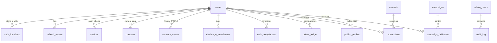

# Data model

Source of truth: `services/api/src/db/schema.ts`. Migrations: `services/api/drizzle/` (generate with `pnpm db:generate`; CI fails if the schema and migrations drift).

| Table | Notes |
| --- | --- |
| `users` | Profile + settings (locale, timezone, prayer method, Hijri offset). `status`: active / suspended / under_review / deletion_requested. |
| `auth_identities` | `(provider, subject)` unique. One user can link Google and Apple. |
| `refresh_tokens` | sha256 of the token only. Rotated on every refresh. |
| `devices` | FCM tokens; `invalidated_at` set when FCM reports the token dead. |
| `consents` / `consent_events` | Current state + immutable history with `source` and `policy_version`. |
| `challenge_enrollments` | `started_on` = day 1 of 365. |
| `task_rules` | Six tasks: Arabic/English label, points, on/off — all admin-editable. Active values must equal the daily total. |
| `streak_milestones` | Automatic one-time bonus when a streak reaches N days (`ref_key milestone:<days>`). |
| `point_grants` | Bulk gifts to a segment; each recipient gets a ledger row `grant:<id>`. |
| `bonus_rules` | White days / Mon–Thu fasting / Friday Kahf. Disabled until approved. |
| `task_completions` | Unique `(user, date, task)` and `(user, client_event_id)`. `is_qada` for make-ups. |
| `points_ledger` | **Append-only.** Unique `(user, ref_key)` makes awards idempotent. `ref_key` patterns: `YYYY-MM-DD:task:<task>`, `YYYY-MM-DD:bonus:<kind>`, `milestone:<days>`, `grant:<grantId>`, `redemption:<id>`, `reversal:redemption:<id>`, `admin:<adminId>:<uuid>`. |
| `public_profiles` | Opt-in «بطاقة يقين» (NFC/QR). Unique lower-case `handle`; `published` false by default and set false on an erasure request or by support; `links`/`show` JSON; `views` = human page opens (a counter, no visitor data). The page computes level (lifetime points), streak and badges (`milestone:*` ledger rows) at read time; the journey timeline is derived the same way (no new table). |
| `rewards` / `redemptions` | Catalogue (cost, value, validity days, monthly cap, per-user monthly limit) and issued Shopify codes. |
| `content_items` | Duas / azkar with workflow `draft → pending_review → published / changes_requested`. |
| `daily_tasks` | One "مهمة اليوم" per date. |
| `campaigns` / `campaign_deliveries` | Push campaigns; deliveries enforce the daily cap and dedupe. |
| `app_config` | Remote config by key (features, minVersion, maintenance, splashVerse). |
| `hijri_adjustments` | Regional offsets effective from a Hijri month. |
| `admin_users` / `audit_log` | RBAC roles; every admin write is audited in the same transaction. |

## Points rules — defaults

Everything below is **edited from the dashboard** (النقاط والمكافآت). Global settings live in `app_config` key `points` (`dailyTotal`, `qadaDayPoints`, `qadaWindowDays`, `challengeLengthDays`). Changes apply to the next request; points already earned never change.

| Task | Points |
| --- | --- |
| وِرد القرآن | 20 |
| أذكار الصباح | 10 |
| الصلوات الخمس | 25 |
| أذكار المساء | 10 |
| الاستماع | 10 |
| مهمة اليوم | 25 |
| **Day total** | **100** |

- **Qada:** a missed/partial day within 7 days can be made up; the whole day is then worth at most **80**.
- **Rewards:** 1,000 = 50 EGP off · 2,500 = 15% off prayer rugs · 4,000 = free shipping.
- **Bonuses (proposed, off):** white days +30 · Mon/Thu fast +30 · Kahf on Friday +20.
- **Streak milestones (proposed, off):** 7 days +50 · 30 days +200 · 100 days +500.
